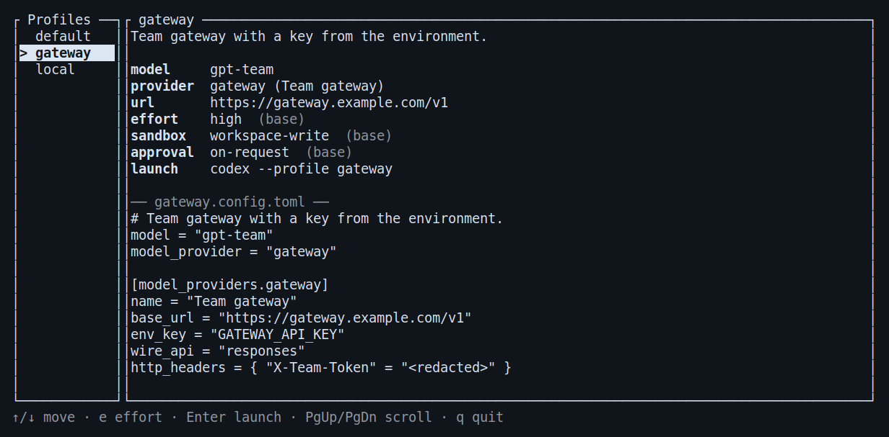
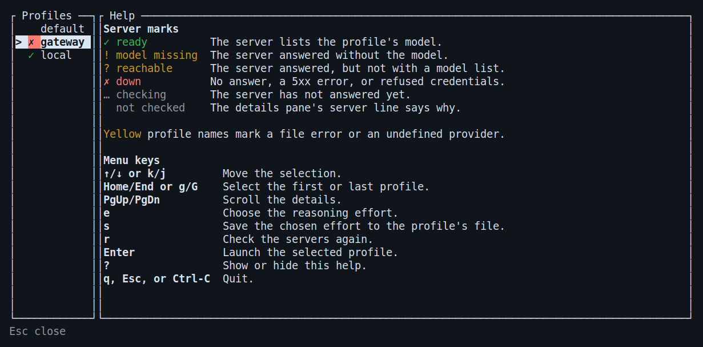

# codex-launcher

A terminal menu for choosing a [Codex CLI](https://github.com/openai/codex)
profile and launching Codex with it. You can also list, inspect, and launch
profiles from the command line, and another program can read and drive a
running menu through `codex-launcher ctl`.



*The menu running with the repository’s sample profiles.*

## Install

Requires Rust 1.94 or newer. Tested on Linux; it uses Unix sockets and `exec`, so
it does not build on Windows.

```sh
cargo install --locked --git https://github.com/aortez/codex-launcher
```

From a clone, `./install.sh` builds and installs it. Run either command again
to update. Cargo puts the binary in `~/.cargo/bin`; if that is
not on your `PATH`, add it or link the binary from a directory that is:

```sh
ln -s ~/.cargo/bin/codex-launcher ~/.local/bin/codex-launcher
```

`cargo uninstall codex-launcher` removes it; remove any link you made too.

## Profiles

Codex loads `$CODEX_HOME/<name>.config.toml` as a layer on top of
`$CODEX_HOME/config.toml` when it runs with `--profile <name>`. `CODEX_HOME`
defaults to `~/.codex`. The launcher lists every such file, sorted by name,
after a `default` entry that runs Codex with `config.toml` alone.

The details pane shows the settings Codex will use. A value marked `(base)`
comes from `config.toml` because the profile does not set it, and
`(built-in)` marks Codex's own default. The `context` and `compact` rows show
`model_context_window` and `model_auto_compact_token_limit` only when the
profile or `config.toml` sets them. The description is the comment block at
the top of the profile file. Values of keys that look like credentials
(`api_key`, `token`, `password`, header, `query_params`, and `env` tables, and
so on), passwords inside URLs, and URL query values are shown as `<redacted>`. Environment variable names
such as `env_key` stay visible.

Profile names may use letters, digits, `-`, and `_`, as Codex requires. Codex
ignores `--profile` for a name with no file; the launcher reports it as an
error instead.

### Wrappers

Some profiles need setup before Codex starts, such as a tunnel or an API key
loaded from a file. If an executable named `codex-<name>` is on `PATH`,
launching profile `<name>` runs it, with any extra arguments, instead of
`codex --profile <name>`. The wrapper must select the profile itself. The
details pane shows the command and the wrapper's path.

## Usage

```sh
codex-launcher                         # Open the menu.
codex-launcher -- resume --last        # Open the menu; pass the arguments to Codex.
codex-launcher local                   # Launch a profile without the menu.
codex-launcher local exec "fix tests"  # Arguments after the profile go to Codex.
codex-launcher local --dry-run         # Print the command instead of running it.
codex-launcher list                    # One line per profile; --json for JSON.
codex-launcher list --check            # Add whether each profile's server is ready.
codex-launcher show gateway            # The details pane as text; --json for JSON.
```

```
$ codex-launcher list
PROFILE  MODEL            PROVIDER  EFFORT  DESCRIPTION
default  gpt-base         openai    high    Runs Codex with config.toml only, without a profile.
gateway  gpt-team         gateway   high    Team gateway with a key from the environment.
local    qwen3-coder:30b  ollama    medium  Local Ollama model on this machine.
```

`list`, `show`, `ctl`, and `help` are subcommands, so profiles with those names
can only be launched from the menu.

In the menu, `↑`/`↓` (or `k`/`j`) move, `Home`/`End` (or `g`/`G`) jump to the
first or last profile, `PgUp`/`PgDn` scroll the details, `r` checks the model
servers again, `?` shows what the keys and the server marks mean, `Enter`
launches, and `q`, `Esc`, or `Ctrl-C` quits. Launching replaces the launcher
process with Codex, so Codex gets the terminal and nothing is left running.

### Server checks

A profile works only if its model server is running and has the model. When the
menu opens, it asks each profile's server for its model list in the background
and marks the profile:

| Mark | State | Meaning |
| --- | --- | --- |
| `✓` | ready | The server lists the profile's model. |
| `!` | model missing | The server answered without the model. |
| `?` | reachable | The server answered, but not with a model list. |
| `✗` | down | No answer, an HTTP 5xx error, or refused credentials. |
| `…` | checking | The server has not answered yet. |

Press `?` in the menu to see these marks explained beside the list:



The `server` line in the details pane gives the reason, such as
`down: connection refused` or `model missing: the server has qwen3-coder:30b`.
After starting a server or an SSH tunnel, press `r` to check again.
`codex-launcher --no-check` opens the menu without contacting servers; `r`
still checks on demand.

The check is `GET <base_url>/models`, which Ollama, vLLM, llama.cpp, and most
OpenAI-compatible gateways answer without loading a model, so a listed model can
still fail to load. Profiles that share a server and headers share one request,
and each request has three seconds to finish. The request uses the same
provider settings as the Ollama lookup under [Changing effort](#changing-effort):
the base URL, `query_params`, headers, and credentials, with redirects refused.
The base URL need not end in `/v1`. A model name without a tag also matches
Ollama's `<name>:latest`.

Profiles without a mark are not checked, and their `server` line says why. This
covers profiles launched through a wrapper, which may start the server or load
credentials first; built-in providers other than `ollama`, such as `openai`;
providers with `requires_openai_auth`; providers whose `env_key` variable is
unset; and launch arguments that select a profile or provider.

### Changing effort

Press `e` to open the effort picker for the selected profile. Use `↑`/`↓`
(or `k`/`j`) to choose a level, then `Enter` to apply it for this launch.
`Esc` cancels. Applying a choice returns to the menu; press `Enter` again
to launch. The details pane marks temporary choices `(override)` and shows
the updated command with `-c 'model_reasoning_effort="high"'`.

Choose **Use profile setting** to clear the temporary override. Each
profile keeps its own temporary choice while the menu is open; closing
the launcher discards those choices. If you supplied an effort through
Codex arguments, the reset choice reads **Use launch arguments** and
restores that value. A menu override takes precedence over those arguments.

To make a choice permanent, press `s` in the picker, or apply it and press
`s` in the main menu. This saves only `model_reasoning_effort` to the selected
`<name>.config.toml`; for `default`, it saves to `config.toml`, affecting
profiles that inherit their effort. Comments, other settings, credentials,
and file permissions are preserved. Invalid TOML and symlinked config files
are not overwritten. Saving clears the temporary override unless it is
still needed to take precedence over an effort in the launch arguments.

The picker runs `codex debug models` to get the model's supported levels,
matching its exact name. Discovery runs on the first `e` or `ctl effort`
interaction for each profile, and results are reused while the menu is open.
Model flags and `-c` overrides are included in discovery; prompts and runtime
subcommands are not. The command has a two-second timeout, and batched `ctl`
keys share a single two-second discovery budget starting when the connection
arrives. Skipped or timed-out lookups use the fallback choices and can retry on
the next interaction. Discovery runs in its own process group, which is
terminated after the query so wrapper subprocesses do not remain running.

Because this diagnostic does not accept `--profile`, named profiles use a
temporary private config snapshot with the same base/profile table merge.
This keeps profile credentials out of process arguments. The snapshot is
removed after the query; the original config files stay in place.

If the command is missing, fails, or has no matching model, the launcher also
checks the configured provider's Ollama `/api/show` endpoint. This uses the
merged profile and runtime model/provider overrides. Built-in
`model_provider = "ollama"` works without a provider table: it uses
`CODEX_OSS_BASE_URL`, or `http://localhost:<port>/v1` with `CODEX_OSS_PORT`
(default `11434`). Custom providers use their configured `base_url`.
The base URL must end in `/v1` (an optional trailing slash is fine); a reverse
proxy's path prefix is preserved.

Discovery includes provider `query_params` with URL encoding. Static headers
are replaced case-insensitively by `env_http_headers` when the environment
variable exists and is nonempty; missing or empty optional variables are
skipped. Authentication prefers `env_key` over `experimental_bearer_token`
and replaces any configured Authorization header. If a configured `env_key`
is missing or empty, discovery keeps the fallback choices instead of using
the inline token. Redirects are refused and OpenAI-login providers are skipped.
Base URLs with embedded credentials, query strings, or fragments are skipped;
use `query_params` for query values. No model is loaded or inference requested
during discovery. HTTP and Codex discovery share the same two-second budget,
including response bodies.

Ollama's advertised `thinking.values` determine the controls where available:

- Named levels appear as effort choices, limited to values Codex can pass.
- Boolean controls appear as **Thinking off (none)** and **Thinking on (medium)**.
  These are on/off controls; `medium` is the compatibility value sent to Codex.
- Models without thinking support offer **Thinking off (none)**, so an
  incompatible inherited effort can be overridden for this launch or saved.
  The inherited setting remains available as a separate choice.

Older Ollama servers may omit `thinking.values`. For those, `capabilities` and
the model family identify GPT-OSS's low/medium/high controls, Qwen3.5/3.6 MoE
(`qwen35moe`) and GLM-4.7-Flash (`glm4moelite`) on/off controls, and models
without thinking. These inferred controls are identified as `Ollama model
family` in state. Unrecognized thinking families remain unverified.

If neither discovery source has matching metadata, the picker falls back to
`model_catalog_json` (relative to `CODEX_HOME`) or the built-in OpenAI provider's
`models_cache.json`. Without matching metadata, it offers common
levels and labels model support as unknown; the provider may reject unsupported
choices. Additional runtime `--profile`, `--oss`, and `--local-provider`
arguments use this unverified fallback. Wrappers must forward the generated
arguments to Codex. The settings pane still shows the base/profile values;
it does not resolve project or managed configuration layers.

## Using it from scripts

Each menu listens on a Unix socket at
`$XDG_RUNTIME_DIR/codex-launcher/<pid>.sock`, in a directory only you can
open. `ctl` finds the menu on its own when one is running; pass `--pid` when
there are several.

```sh
codex-launcher ctl instances       # Running menus: pid, terminal, directory, selection.
codex-launcher ctl state           # The menu, the selection, and the command Enter runs.
codex-launcher ctl screen          # The screen as plain text.
codex-launcher ctl key down down   # Press keys, then print the new state.
codex-launcher ctl select local    # Move the selection to a profile by name.
codex-launcher ctl effort high     # Set a temporary effort for the selection.
codex-launcher ctl effort profile  # Clear the override; restore profile/arguments.
codex-launcher ctl save-effort     # Save the temporary effort to the selected file.
codex-launcher ctl launch          # Launch the selection, like pressing Enter.
codex-launcher ctl quit
```

Keys go through the same keymap as the keyboard. Key names are `up`, `down`,
`left`, `right`, `home`, `end`, `pgup`, `pgdn`, `enter`, `esc`, `tab`,
`backspace`, `space`, `ctrl-<letter>`, or a single character such as `q`. A
request with an unknown key or profile name changes nothing and exits with
status 1. A reply comes after the menu has applied the request and redrawn, so
it always matches the screen.

`ctl state` reports the effective effort in `profile.effort` and each menu
entry. `effort_override` is the selected profile's temporary choice, or null;
`effort_choices` includes the available levels, their metadata source
(null when support is unknown), and `control` (`levels`, `toggle`, `off_only`,
`unsupported`, or `unknown`). Toggle levels remain `none` and `medium` in `ctl`
commands and saved config; `off_only` permits only `none`. `unsupported` means
no advertised control can be expressed through Codex. `effort_picker` reports
the open picker's selected index, where zero means inheritance, or null when closed. `notice`
contains save feedback or a keyboard-action error, when present. Invalid
`ctl effort` values fail without changing the current choice.

`profile.server` reports the selected profile's server check: its `state`
(`checking`, `ready`, `model_missing`, `reachable`, `down`, or `skipped`) and a
`message` with the reason, or null. Each `menu` entry has its `server` state.
`ctl key r` checks again; read `ctl state` until no entry is `checking`. With
`--no-check`, these fields are absent until the first check.
`list --check --json` adds the same `server` object to each profile.

`help` is null unless the help screen is open, from the keyboard or from
`ctl key '?'` (quote the `?` so the shell does not expand it); then it reports
the help's `scroll` and `max_scroll`. While the help or the effort picker is
open, keys go to it instead of the menu: `r` does not check the servers, and
`Esc` or `q` closes it rather than quitting. Read `help` and `effort_picker`
before sending menu keys.

```
$ codex-launcher ctl key down
{
  "pid": 41237,
  "mode": "tui",
  "tty": "/dev/pts/3",
  "cwd": "/home/me/project",
  "codex_home": "/home/me/.codex",
  "status": "selecting",
  "selected": "gateway",
  "selected_index": 1,
  "command": ["codex", "--profile", "gateway"],
  "command_line": "codex --profile gateway",
  "menu": [
    {"name": "default", "model": "gpt-base", "provider": "openai", "effort": "high", "server": "skipped"},
    {"name": "gateway", "model": "gpt-team", "provider": "gateway", "effort": "high", "server": "ready"},
    {"name": "local", "model": "qwen3-coder:30b", "provider": "ollama", "effort": "medium", "server": "down"}
  ],
  "profile": {"name": "gateway", "model": {"value": "gpt-team", "source": "profile"}, ...},
  "details": {"scroll": 0, "max_scroll": 0},
  "warnings": []
}
```

### Headless mode

`codex-launcher --headless` runs the same menu without a terminal. It draws to
an offscreen screen (`--size 100x30` by default) that `ctl screen` reads, and
when launched it prints the command on stdout and exits instead of running it.
Tests and agents can drive it the same way as a menu in a terminal.

```sh
codex-launcher --headless -- resume --last &
codex-launcher ctl select local
codex-launcher ctl launch       # The headless menu prints: codex --profile local resume --last
```

## Development

CI runs on pull requests and pushes to `main`, using Rust 1.94.1 on Linux.
It checks formatting, runs the tests, and treats Clippy warnings as errors.
The checks use fixtures and loopback servers; no model servers or credentials
are required. Run the same checks locally with:

```sh
cargo fmt --all --check
cargo test --locked
cargo clippy --locked --all-targets -- -D warnings
```

`tests/fixtures/codex-home` is a made-up Codex home used by the tests and the
examples above.

## License

MIT. See [LICENSE](LICENSE).
